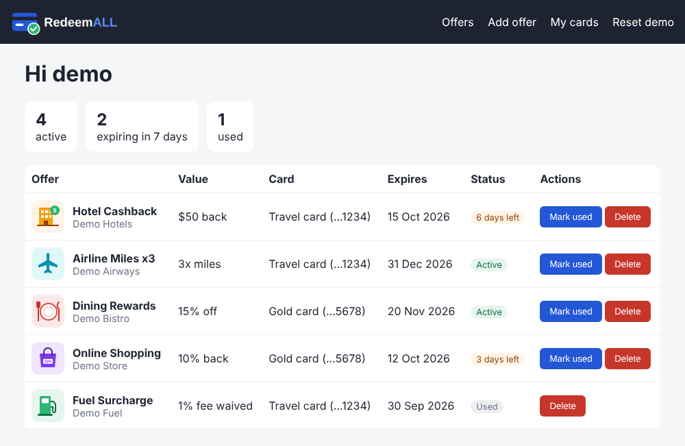

# Stage 1: Secure Azure VM web server

## Goal
Create a Linux VM in Azure inside its own virtual network, lock it down with a network security group, and host a PHP web page on it.

## What I built
- **Resource group:** _TBD_
- **Region:** _TBD_
- **Virtual network (VNet):** _TBD_ (address space _TBD_), subnet _TBD_
- **Network security group (NSG):** rules listed below
- **Virtual machine:** _TBD_ (Ubuntu _TBD_, size _TBD_)
- **Web server:** _TBD_ with PHP

## NSG rules
| Priority | Name | Port | Source | Action |
|----------|------|------|--------|--------|
| _TBD_ | SSH | 22 | _TBD_ | Allow |
| _TBD_ | HTTP | 80 | Any | Allow |

## Steps
1. Created the resource group and VNet with a subnet.
2. Created the NSG, added the rules above, and attached it to the _TBD_.
3. Created the Ubuntu VM in that subnet, signed in with _TBD_.
4. Installed the web server and PHP on the VM.
5. Copied `index.php` from my laptop to the VM with WinSCP.
6. Opened the site at `http://<public-ip>/`.

## Files
| Path | What it is |
|------|------------|
| [`app/index.php`](app/index.php) | The PHP offers page served by Apache on the VM |
| [`app/IMAGES/`](app/IMAGES/) | Logo and offer icons used by the page (PNG + SVG) |
| [`app/basic.html`](app/basic.html) | The first static HTML version of the page |
| [`app/templates/`](app/templates/) | HTML templates and `css/style.css` for the RedeemALL app screens (offers, cards, add offer, login) |
| [`docs/SETUP-STEPS.md`](docs/SETUP-STEPS.md) | Commands used to install Apache/PHP, copy files and set permissions |
| [`screenshots/`](screenshots/) | Screenshots of the running site |

## What I learned
_TBD_
