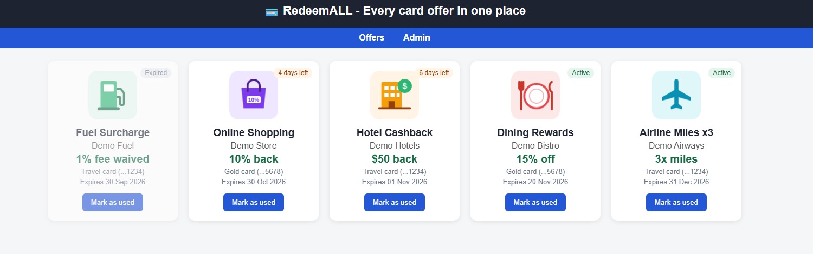

# Stage 2: A real database for RedeemALL

> Part of the **RedeemALL** idea: one place to track every credit card offer so none expire unused. See the [main page](../README.md).
> In Stage 1 the offers were typed into the PHP code. In Stage 2 they live in a **MySQL database on a private VM**, and the website reads and updates them from there.



*Live screenshot from my web VM: every card on this page comes from the `offers` table on the private DB VM.*

## What changed from Stage 1
| | Stage 1 | Stage 2 |
|---|---|---|
| Where offers live | Hard-coded in `index.php` | MySQL database `REDEEMALL` |
| Servers | 1 web VM | Web VM + private database VM |
| "Mark as used" | Lost when the session ended | Saved permanently in the database |
| Adding an offer | Edit the code | Add a row to the `offers` table |

## Architecture
```
Internet
   │  HTTP :80
   ▼
Web VM (Apache + PHP)  ─── WebSUB 10.0.1.0/24 ─┐
   │                                           │  RedeemALL_vnet 10.0.0.0/16
   │  MySQL :3306 (private network only)       │  Resource group RedeemALL
   ▼                                           │  Canada Central
DB VM redeemall-db (MySQL 8) ── DbSUB 10.0.2.0/24
   NO public IP
```

## What I built
| Resource | Setting | Why |
|---|---|---|
| Subnet | `DbSUB` `10.0.2.0/24` | Keeps the database tier separate from the web tier |
| DB VM | `redeemall-db`, Ubuntu 24.04, **no public IP** | Nobody on the internet can even see it |
| DB NSG | Ports 3306 and 22 allowed **only from WebSUB** (10.0.1.0/24); everything else denied | Only the web VM can talk to the database |
| Database | MySQL 8, database `REDEEMALL` | Stores cards and offers |
| DB user | `redeemuser@'10.0.1.%'` | Even with the password, it only works from the web subnet |
| Admin access | SSH to the DB VM by jumping through the web VM | No extra public IP needed |
| Secrets | `db.php` stays on the server and is in `.gitignore`; the repo only has `db.example.php` | Keeps the real password out of this public repo |

## Database design
```
cards                         offers
-----                         ------
id (PK)          1 ───< many  id (PK)
nickname                      card_id (FK -> cards.id)
bank                          title, merchant, value_text
last_four                     expires_on
                              is_used
                              image  (file name in IMAGES/ or a full URL)
```
Only the last 4 digits of a card are stored, never the full number. Full SQL: [db/redeemall.sql](db/redeemall.sql).

## How the page works
1. `db.php` opens a connection to MySQL on the DB VM's private IP.
2. `index.php` joins `offers` with `cards` and shows each offer as a card.
3. The status badge (Active, *N days left*, Expired, Used) is worked out from `expires_on`.
4. **Mark as used** updates `is_used` in the database.

## Files
| Path | What it is |
|---|---|
| [`app/index.php`](app/index.php) | The offers page, reading from MySQL |
| [`app/db.example.php`](app/db.example.php) | Connection settings template (copy to `db.php` on the server) |
| [`db/redeemall.sql`](db/redeemall.sql) | Creates the database, tables, demo data and app user |
| [`docs/SETUP-STEPS.md`](docs/SETUP-STEPS.md) | Step-by-step commands I used |

## Problems I hit and how I fixed them
| Problem | Cause | Fix |
|---|---|---|
| New VM couldn't download MySQL | `DbSUB` was a *private subnet* (no default outbound internet) and the VM has no public IP | Turned off "private subnet" on `DbSUB` |
| HTTP 500 after switching to the new page | PHP crashed with *Access denied ... to database 'RedeemALL'* | MySQL database names are case-sensitive on Linux: matched `REDEEMALL` in `db.php` and in the `GRANT` |
| Page loaded with no styling | `css/style.css` wasn't on the server | Built the styles into `index.php` |

## What I learned
- How to split an app into a **web tier** and a **database tier** in separate subnets.
- A VM with **no public IP** can still be managed by jumping through another VM.
- NSG rules plus MySQL user host limits give two layers of protection.
- Reading `/var/log/apache2/error.log` turns a blank "HTTP 500" into the real error.

## Next
- [Stage 3](../stage-3-storage-account/): move the offer images into an **Azure Storage account** reached through a private endpoint.
- [Stage 4](../stage-4-scale-set-load-balancer/): run the web tier as a VM Scale Set behind a load balancer.
- Switch VM sign-in from passwords to SSH keys.
